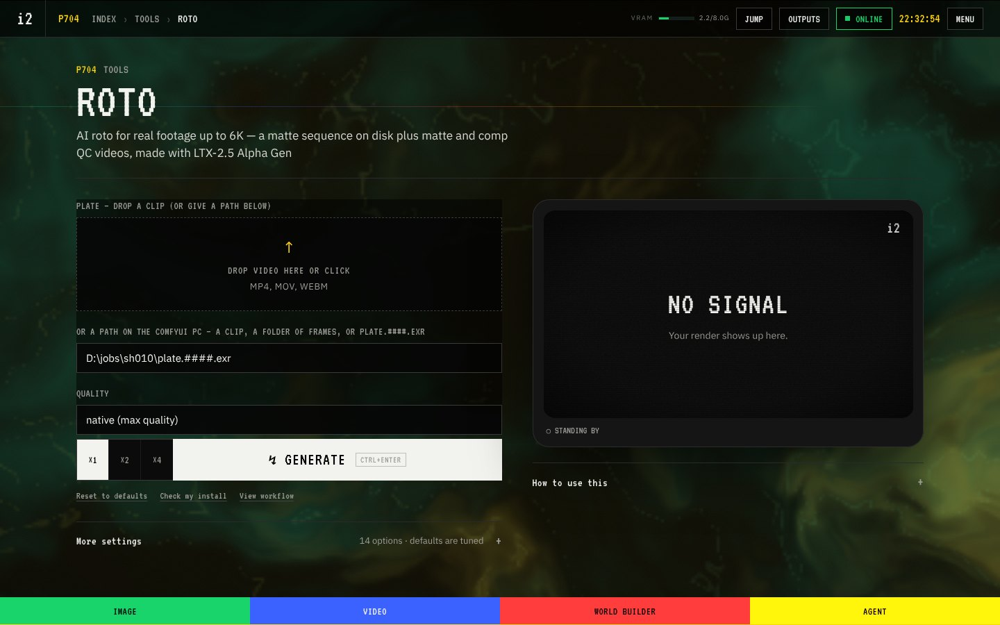

# ComfyUI-i2-Roto

Production roto mattes from live-action plates, up to 6K, with Lightricks' **LTX-2.5 Alpha Gen IC-LoRA**.
RGB plate in, 16-bit grayscale matte sequence out. No prompt, no mask.

The model works in a window of at most 1920x1088 and 145 frames. For bigger plates the pack does three things:

1. **Proxy pass**: the whole frame, scaled to fit the window, gives a global matte (what is foreground).
2. **Detail pass**: window-size crops ("tiles") at native resolution, only where the matte has edges,
   run through the same model, so hair and soft edges are real native-resolution detail.
3. **Assemble**: the tiles are blended into the upscaled proxy inside the edge band and the matte is written
   at the plate's native size, one frame at a time from disk. RAM stays flat whatever the shot length.

Core ComfyUI nodes plus this pack only. It does not need ComfyUI-LTXVideo, VideoHelperSuite, KJNodes or anything else.

## Install (4 steps)

1. Copy or `git clone` this folder into `ComfyUI/custom_nodes/ComfyUI-i2-Roto`.
2. OpenCV must be importable from ComfyUI's Python. It usually is already (other node packs install it).
   If not: `python -m pip install opencv-python` with ComfyUI's Python.
3. Put the five model files in place (accept the LoRA license on Hugging Face first, it is gated:
   https://huggingface.co/Lightricks/LTX-2.5-22b-IC-LoRA-Alpha-Gen):

   | file | folder |
   |---|---|
   | `ltx-2.5-22b-distilled-transformer-comfy-int8-convrot.safetensors` | `models/diffusion_models/` |
   | `ltx-2.5-22b-ic-lora-alpha-gen-0.9.safetensors` | `models/loras/LTX/` (the workflow points there; re-pick it if yours is elsewhere) |
   | `ltx-2.5-video-vae-bf16.safetensors` | `models/vae/` |
   | `ltx-2.5-audio-vae-bf16.safetensors` | `models/vae/` |
   | `gemma4-12b-with-proj-ltx-2.5-comfy-int8-convrot.safetensors` | `models/text_encoders/` |

4. Restart ComfyUI and open `workflows/i2_Roto_LTX25_AlphaGen_HiRes.json`. Paste your plate path into
   **i2 Roto · Setup** and queue.

## Use it from the i2 Creative Hub

The [i2 Creative Hub](https://github.com/i2interactive/i2-creative-hub) (1.26 and newer) has this pack as the **Roto** tool in its Tools channel. Drop a clip on it, or type a path on the ComfyUI PC (a clip, a folder of frames, or `plate.####.exr`), and press Generate. The matte and comp QC videos land in the hub's gallery and the report shows next to them. If the pack or a model file is missing, the hub offers an Install button for the pack and Download buttons for the five model files.

## Using it

Everything you set is on **i2 Roto · Setup**. The rest of the graph you don't touch.

- **plate_path**: a video file (ProRes, DNxHR, H.264, H.265; 8/10/12-bit), a folder of frames, or a sequence:
  `shot.####.exr`, `shot.%04d.exr`, or just the path of any one frame. Quotes and either slash direction are fine.
  A plain file name (or `input/name.mov`) is also looked for in ComfyUI's input folder, so uploaded clips work (1.0.1).
  Sequences: png, jpg, tif, exr (dpx only if your OpenCV can read it).
- **start_frame / frame_count**: which part of the clip. 0 / 0 = everything.
- Check the **Setup info** box and the first-frame preview before a long run. It shows size, frame count,
  proxy size, chunk plan and the working resolution of the detail pass.

### The settings that matter

| setting | what it does |
|---|---|
| `window` | Model window. `1920x1088` (default) is what the model was trained at. `1536x864` / `1280x704` use less VRAM and are faster, with a softer proxy. |
| `chunk_frames` | Frames per model run (snapped to 8n+1, 9..145). Default 49. Longer chunks = fewer joins, more VRAM and time per job. |
| `detail` | `native` = tiles at the plate's own resolution (best edges, most jobs). `2x proxy` = tiles at twice the proxy resolution (fewer jobs). `proxy only` = no tiles, the proxy matte is upscaled with an edge-aware (guided) filter. |
| `band_px` | Half-width of the edge band in plate pixels. Only the band gets tile detail. Raise it for big motion blur. |
| `tile_overlap` | Overlap between tiles (blend zone). 256 is fine. |
| `tile_trust` | 1 = tiles fully replace the proxy inside the band. Lower it if a tile ever disagrees badly with the proxy. |
| `pin_chunks` | Pins the first frame of each chunk to the last matte frame of the previous one so chunks join smoothly. Leave on. |
| `black_clip` / `white_clip` | Levels on the final matte (cleans near-black and near-white noise). |
| `edge_shift_px` | Negative chokes, positive spreads, in plate pixels. |
| `invert` | Inverts the output. |
| `garbage_matte_path` | Optional video/sequence/single image. White = keep. Multiplied into the matte. |
| `plate_color` | Only changes what the model sees, never the matte. `linear (EXR) -> sRGB` for scene-linear EXRs, `log -> auto normalize` for camera log footage. |
| `output_folder` | Empty = `ComfyUI/output/i2roto/<plate>_matte/`. A relative path goes under `ComfyUI/output/`. |
| `output_format` | PNG 16-bit (default), EXR half (single channel "Y"), TIFF 16-bit. |
| `write_rgba` | Also writes the plate with the matte as straight alpha, 16-bit PNG, into `<output>_rgba/`. The plate there is in display space after `plate_color`: for quick comps and checks, not for finishing. |
| `start_number` | First output frame number for video plates. Numbered sequences keep their own frame numbers. |
| `keep_cache` | Keeps the per-run cache (proxy and tile mattes) in `ComfyUI/temp/i2roto/` for debugging. |

Output files are named `<plate name>_matte.<frame>.<ext>` with at least 4-digit numbers.
The **Output** group also saves two small QC videos (`i2roto/qc_matte`, `i2roto/qc_comp`, at most 96 frames,
960 px wide) and shows a report.

## What to expect on 8 GB vs bigger cards

- The model, text encoder and VAEs are loaded once and stay outside the loops. Each loop iteration is one model
  run on one window-size job, so VRAM use is set by `window` and `chunk_frames`, not by the plate size.
- On an 8 GB card start with the defaults (1920x1088, 49 frames). If you run out of VRAM, drop `window` to
  `1536x864` or `1280x704`, or lower `chunk_frames`.
- More VRAM lets you use longer chunks (fewer joins). It does not change the number of jobs.
- RAM: one job's frames are in memory at a time (49 frames at 1920x1088 is about 1.2 GB as float32,
  145 frames about 3.6 GB), plus ComfyUI and the models.
- Disk: the cache holds 16-bit PNG mattes for the proxy and every tile frame until Assemble finishes.

## Speed on an RTX 3070 Ti (8 GB)

Measured on the RTX 3070 Ti (8 GB VRAM, 32 GB RAM, ComfyUI 0.45.3) on 2026-11-12, models already loaded.
One job = one model run on one window:

| window | chunk_frames | time per job |
|---|---|---|
| 1280x704 | 49 | about 1.5 min (real Alpha Gen run on a real clip) |
| 1920x1088 | 49 | about 4 min (same model chain, grey test frames, no LoRA) |
| 1920x1088 | 81 | about 10.6 min (same) |

End to end on 2026-11-25 (ComfyUI 0.46.3): 24 frames of a 3840x2160 iPhone clip at `proxy only` with the 1280x704 window took about 85 s from Setup to the written 16-bit PNG sequence, including about 14 s (0.6 s a frame) for Assemble to write the 4K frames.

So 49-frame chunks are the efficient size on this card; 81 works but costs 2.6x the time for 1.65x the frames.

Total time = number of jobs x time per job. Jobs = chunks x (1 proxy + tiles that touch an edge).
A chunk covers 48 new frames (2 seconds at 24 fps). Rough guide at the default 1920x1088 window, per 2 seconds of footage:

- Plate up to 1920x1088: 1 job, about 4 min.
- 4K or 6K, `proxy only`: 1 job, about 4 min.
- 6K, `2x proxy`: the synthetic 6K test plate (one figure, about 10% of the frame) needed 6 tiles: 7 jobs, about 30 min.
- 6K, `native`: the same plate needed 12 tiles: 13 jobs, about 50 min.

A subject that fills more of the frame needs more tiles; a small subject needs fewer. The Plan Detail info box
shows the job count as soon as the proxy pass is done. These totals are estimates from the per-job times above,
not measured end-to-end runs.

## Limits

- Video plates are assumed to be constant frame rate. Frames are mapped by timestamp; variable-frame-rate
  phone footage may drop or repeat frames. Convert VFR footage to an image sequence or a CFR ProRes first.
- The model sees an 8-bit-like display picture. Super-bright or very dark log footage may need
  `log -> auto normalize`, which is a simple per-shot levels stretch, not a camera-accurate transform.
- EXR in needs an OpenCV build with OpenEXR. The current `opencv-python` 5.x pip wheels are built without it
  (4.x wheels have it). EXR *out* works either way: the pack has a small built-in EXR writer it uses when
  OpenCV can't write EXR.
- The detail pass only looks where the proxy found an edge. Strands or soft edges the proxy completely missed
  (nothing above ~2% in the proxy matte) are not picked up by the tiles.
- Each tile is matted on its own. If a tile sees only part of the subject, the model has less context there;
  the proxy decides what is foreground outside the edge band.
- Garbage matte timing: if it has at least as many frames as the whole plate, its frames line up with the plate's.
  If it is shorter, its frame 0 lines up with the first processed frame (`start_frame`) and its last frame is held.
  A single image is used for every frame.
- The run cache is deleted after a successful Assemble. If a run fails half way, its cache stays in
  `ComfyUI/temp/i2roto/` until ComfyUI clears its temp folder on the next start.

## Nodes

- **i2 Roto · Setup**: all settings; makes the run plan.
- **i2 Roto · Load Job**: reads one job's frames (whole frame or one tile) from disk.
- **i2 Roto · Store Job**: writes the decoded matte of one job to the run cache; outputs the next pin.
- **i2 Roto · Plan Detail Pass**: finds the edge band and plans the tile x chunk jobs.
- **i2 Roto · Assemble + Write**: blends, upscales, applies the finishing controls and writes the sequence.

The workflow JSON is generated by `tools/build_workflow.py`.

## Changes

- **1.0.1** (2026-11-25): plain file names for the plate and the garbage matte are also looked for in ComfyUI's input folder.
- **1.0.0** (2026-11-25): first release.

## Licences

- **This node pack:** MIT license, (c) i2 interactive LLC. See `LICENSE`.
- **The LTX-2.x models it runs are not covered by that.** They come under Lightricks' own licence, which is free for individuals and for companies under $10M in annual revenue. Companies at $10M+ need a paid commercial licence from Lightricks before using the models. Check Lightricks' current terms on the model pages before commercial use.
